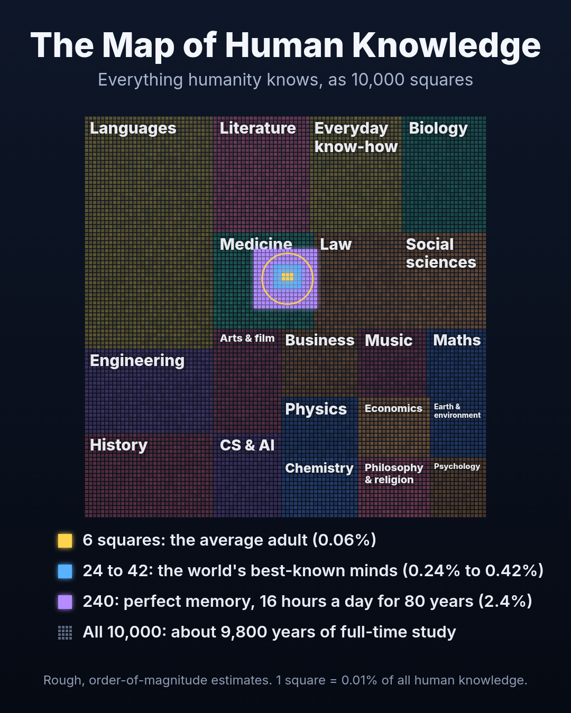

# The Map of Human Knowledge

An order-of-magnitude model of how much of humanity's organized knowledge one person can hold.

> **Status: v1, exploratory.** This is the model behind the explainer videos and poster published in October 2026. Its field sizes and the depth levels assigned to people rest on judgment calls, so it is now being rebuilt on more measurable anchors, with a preprint planned for December 2026. Treat every number here as a rough estimate that could be off by a factor of about two either way.



## What it estimates

All of humanity's organized knowledge is split into 20 fields, sized in one common unit and drawn as 10,000 squares. Each square is 0.01% of the map, roughly one year of full-time study. Any person's knowledge can then be estimated and drawn on the same scale.

## v1 results

| Profile | Share of the whole map | Squares (of 10,000) |
|---|---|---|
| Average adult | 0.061% (P10 to P90: 0.028% to 0.11%) | about 6 |
| Typical Indian engineering graduate, about 5 years in IT | 0.12% (0.054% to 0.21%) | about 12 |
| 16 well-known people (Tao, Chomsky, Gates, Obama, Musk and others) | 0.24% to 0.42% (central estimates) | 24 to 42 |
| Realistic lifetime ceiling: 50 years of full-time learning | 0.51% | about 51 |
| Perfect memory, 16 hours a day for 80 years | 2.4% | about 240 |

- **The whole map** comes to about 94 million knowledge units after removing overlaps between fields, roughly 9,800 years of full-time study.
- **Depth is local.** Terence Tao is estimated to hold about 6% of mathematics (P10 to P90: 2.1% to 14%) and about 0.3% of everything.
- **Comparisons hold up better than absolute values.** In the middle 80% of the 6,000 simulated worlds, each of the 16 individuals holds between about 2.8 and 8.5 times what the average adult holds.

Every profile's numbers are in [`results/coverage_summary_v1.csv`](results/coverage_summary_v1.csv), and the full output, including each field for each profile, is in [`results/model_output_v1.json`](results/model_output_v1.json).

## How the model works

1. **A common unit.** One knowledge unit (KU) is roughly what takes about 12.5 minutes of focused study to learn and keep: one concept, one method, or about ten words of vocabulary. The 12.5-minute figure is a calibration choice, not a measured constant. It makes the expert level (80,000 KU) equal about 16,700 hours, in line with research on expertise (for example, the roughly 50,000 familiar patterns chess masters hold; Gobet and Simon, 1996). It mainly sets the time figures; comparisons between people do not depend on it.
2. **Field sizes.** Each field gets a central size and a low-to-high range in KU, anchored on a catalog of what it contains (table below). A size is the field's consolidated core, roughly what a complete library of its textbooks and reference works would hold.
3. **Overlap.** Neighboring fields share knowledge, so overlaps are removed with fixed factors (for example 30% between biology and medicine, 25% between mathematics and physics) using first-order inclusion-exclusion.
4. **A depth ladder.** Each person gets a level in every field, from 0 (everyday exposure, 200 KU) to 6 (world-class, 180,000 KU), interpolated on a log scale and judged from public records. Languages are counted as languages known × proficiency × 12,000 KU, plus linguistics on the ladder.
5. **Coverage.** Units held in a field ÷ size of the field. Overall coverage is the union of units held ÷ the union of the map.
6. **Uncertainty.** 6,000 Monte Carlo runs vary every field size within its range, the size of the whole map (×/÷ 2), the ladder calibration (×/÷ 1.6), every assigned level (typical shift 0.35 of a level), language proficiency, and the overlap factors (0.5 to 1.5 times). Ranges are the 10th to 90th percentiles.

## Field sizes and anchors (v1)

| Field | Central size (million KU) | Range | Anchor |
|---|---|---|---|
| Mathematics & logic | 3 | 1.5 to 8 | MSC2020 has 63 areas, 529 sub-areas and 6,022 leaf topics |
| Physics & astronomy | 3.5 | 1.5 to 9 | Particle to cosmic scales; judged similar in core size to mathematics |
| Chemistry | 3.5 | 1.5 to 10 | CAS Registry lists 290M+ substances (the long tail); the core is far smaller |
| Earth & environment | 2.5 | 1 to 6 | Smaller research base than physics or biology |
| Biology & nature | 7 | 3.5 to 18 | About 2.1M described species (Catalogue of Life); molecular to ecosystem scales |
| Medicine & health | 7 | 3.5 to 18 | ICD-11: ~17,000 codes, 120,000+ codable terms; SNOMED CT: 350,000+ concepts |
| Computer science & AI | 4 | 2 to 10 | ACM CCS four-level taxonomy, plus fast-changing technology stacks |
| Engineering & technology | 8 | 4 to 20 | OpenAlex's largest field (63.3M works, June 2026); dozens of disciplines |
| Economics | 3 | 1.5 to 8 | JEL classification, plus the economies of 190+ countries |
| Business & work | 4 | 2 to 10 | General practice plus knowledge of thousands of industries and firms |
| Law & civics | 6 | 3 to 15 | 190+ national legal systems, each with its own statutes and case law |
| Psychology | 2.5 | 1.2 to 6 | Core theory is compact; the empirical literature is large |
| Social sciences | 6 | 3 to 15 | OpenAlex's second-largest field by volume |
| History | 8 | 4 to 20 | Every region and period of the human past |
| Philosophy & religion | 3 | 1.5 to 8 | Academic philosophy plus thousands of religious traditions and texts |
| Visual arts, film & design | 5 | 2 to 12 | Millions of catalogued works across every culture and medium |
| Music | 3.5 | 1.5 to 9 | Hundreds of traditions, each with its own theory and repertoire |
| Literature | 8 | 4 to 20 | About 130M distinct book titles (Google Books count, 2010) |
| Languages & linguistics | 22 | 8 to 60 | 7,170 living languages (Ethnologue, 2026); 600-2,200 class hours each for working proficiency (FSI) |
| General & practical | 8 | 3 to 20 | About 7M English Wikipedia articles, 66M+ across all languages |

The OpenAlex figures come from a published secondary analysis of OpenAlex (a June 2026 snapshot), not from direct queries.

## Limitations

- **Judgment calls.** Field sizes and people's depth levels are anchored on catalogs and public records, but they are judgments, not measurements. Two careful estimators could reasonably differ by half a level on many cells.
- **Public record only.** Private reading, hobbies and skills are invisible. Levels outside a person's documented field are the least reliable cells.
- **Tacit skill is undercounted.** A surgeon's hands or a musician's performance is real knowledge that this unit captures poorly.
- **Forgetting and overlap are handled crudely,** and the anchors lean on English-language sources.
- **Not a verdict on anyone.** Coverage says nothing about intelligence, creativity, impact or worth.

## Roadmap (v2, in progress)

- Rebuild field sizes from countable anchors: sub-area counts in MSC2020, the ACM Computing Classification System and MeSH, combined with the length of real degree programs.
- Add education-based profiles (for example a school leaver, a graduate and a doctorate holder) that can be checked against real program lengths.
- Validate against independent estimates: Landauer (1986) on the capacity of long-term memory, Brysbaert et al. (2016) on vocabulary size, and chess-memory research (Simon and Chase, 1973; Gobet and Simon, 1996).
- Post a preprint and an archived release with a DOI, planned for December 2026.

Corrections and criticism are welcome. Please open an issue.

## Run it

```bash
pip install numpy
python model_v1.py
```

It takes under a minute, prints the coverage table, and rewrites `results/model_output_v1.json`. The random seed is fixed, so the numbers above reproduce exactly.

## How this was made

The research, modeling and code were developed with the help of an AI assistant (Anthropic's Claude). Every source and assumption is written into the code so that it can be checked and challenged.

## Author

Ramu Sriram, independent researcher. ORCID: https://orcid.org/0009-0006-2086-0018

## License

Code: MIT (see [LICENSE](LICENSE)). Text, results and figures: [CC BY 4.0](https://creativecommons.org/licenses/by/4.0/).
